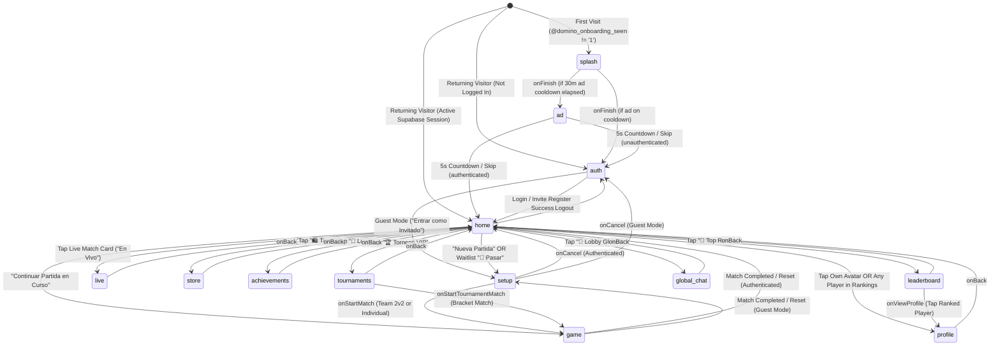

# Domino VIP (PeSiMistas) — Full-System Graphify Report (`v3.0.0-full-system`)

> **Target Consumer**: **Claude Code** (Frontend Design, Visual Polish & Automated E2E QA Agent)  
> **Backend & Architecture Brain**: **Antigravity**  
> **Machine-Readable Knowledge Graph**: [`graphify-out/graph.json`](file:///home/lya/proyectos/Domino/graphify-out/graph.json)  
> **Automated E2E QA Matrix**: [`graphify-out/qa_matrix.json`](file:///home/lya/proyectos/Domino/graphify-out/qa_matrix.json)  
> **Interactive Graph Explorer**: [`graphify-out/graph.html`](file:///home/lya/proyectos/Domino/graphify-out/graph.html)  
> **Live Browser Runtime Bridge**: `window.__DOMINO_GRAPHIFY__` (defined in [`src/lib/graphifyBridge.ts`](file:///home/lya/proyectos/Domino/src/lib/graphifyBridge.ts))

---

## 1. Full-System Topology Summary

| Metric | Count | Details |
| :--- | :---: | :--- |
| **System Communities** | **8** | Core Router, Backend Services, Onboarding/Auth, Gameplay/Live, Social/Economy, UI Components, Database/SQL, PWA/Build |
| **Total Graph Nodes** | **51** | 11 Screens, 5 Components, 7 Services, 4 Core Files, 11 DB Tables, 4 DB RPCs, 4 SQL Scripts, 5 Config/PWA Files |
| **Directed Edges** | **49** | Complete routing, component composition, service invocation, and database mutation edges |
| **System Hyperedges** | **6** | End-to-end multi-node pipelines (Offline Outbox, <100ms Realtime, Pedir Mesa, Betting Payouts, Cosmetics Economy, Tournaments) |
| **QA Test Suites** | **14** | 100% screen, modal, component, and backend service coverage (`QA-01` through `QA-14`) |

---

## 2. The 8 System Communities (Complete File Inventory)

### Community 1: Core Router, State Machine & Design System (`core_router`)
- **[`index.ts`](file:///home/lya/proyectos/Domino/index.ts)**: Expo root entry point (`registerRootComponent(App)`).
- **[`App.tsx`](file:///home/lya/proyectos/Domino/App.tsx)** (`1,592 lines`): Central state machine managing all **13 `ScreenState` routes** (`splash`, `ad`, `auth`, `home`, `setup`, `game`, `live`, `profile`, `store`, `achievements`, `leaderboard`, `global_chat`, `tournaments`), browser `#hash` history synchronization, version check against `app_config`, password recovery interception, Offline Sync Status Banner, Global Chat/Bet Won animated toast, 30-second Urgent Waitlist Call Modal (`¡A LA MESA!`), and Graphify controller registration (`registerGraphifyControllers`).
- **[`src/types.ts`](file:///home/lya/proyectos/Domino/src/types.ts)**: Core TypeScript interfaces (`Team`, `GameMode`, `Player`, `Round`, `Substitution`, `Match`, `Profile`).
- **[`src/theme.ts`](file:///home/lya/proyectos/Domino/src/theme.ts)**: Dark-slate visual design tokens (`background: #0f172a`, `card: #1e293b`, `team1: #3b82f6`, `team2: #10b981`, `accent: #f59e0b`, `error: #ef4444`).

### Community 2: Backend, Offline Outbox, Realtime & Graphify Services (`backend_services`)
- **[`src/lib/supabase.ts`](file:///home/lya/proyectos/Domino/src/lib/supabase.ts)**: Singleton `@supabase/supabase-js` client with `AsyncStorage` session persistence and Web URL token detection.
- **[`src/lib/offlineSync.ts`](file:///home/lya/proyectos/Domino/src/lib/offlineSync.ts)**:
  - **Stale-While-Revalidate (SWR) Cache**: Instant (<10ms) synchronous and asynchronous access to `profiles` (`@domino_cached_profiles_v1`) and `matches` (`@domino_cached_matches_v1`). `getProfiles()` returns a hybrid `Profile[] & { profiles, profileMap }`.
  - **Persistent FIFO Offline Outbox (`@domino_offline_queue_v1`)**: Queues `CREATE_MATCH`, `UPDATE_MATCH`, and `COMPLETE_MATCH` operations while offline and flushes them in order when `window.ononline` triggers or `flushQueue()` is called.
- **[`src/lib/realtimeManager.ts`](file:///home/lya/proyectos/Domino/src/lib/realtimeManager.ts)**:
  - **Waitlist Channel (`domino_waitlist_calls`)**: Singleton channel multiplexing `call_duo`, `proximity_alert`, `waitlist_refresh` broadcasts and `postgres_changes` on `public.waitlist`.
  - **Match Channel (`sync_match_<matchId>`)**: Combines <100ms WebSocket `broadcast` (`match_update`) with `postgres_changes` (`UPDATE` on `public.matches`).
- **[`src/lib/bettingService.ts`](file:///home/lya/proyectos/Domino/src/lib/bettingService.ts)**:
  - `placeMatchBet`: Verifies fresh balance, inserts `pending` bet into `public.bets`, deducts `betting_points` from `public.profiles`, and rolls back if deduction fails.
  - `settleMatchBetsAndWagers`: Triple-redundant payout engine invoking `SECURITY DEFINER` RPCs (`resolve_match_bets` and `resolve_match_wagers`) + atomic client fallback (`status = 'pending' -> 'won'`) + idempotent VIP match wager transfers.
  - `reconcileUserPendingBets`: Self-healing reconciler executed on login, `HomeScreen` load, and `ProfileScreen` load so any user with pending winning bets on completed matches immediately receives `FLOOR(amount_wagered * multiplier)` in `profiles.betting_points`.
- **[`src/lib/waitlistService.ts`](file:///home/lya/proyectos/Domino/src/lib/waitlistService.ts)**:
  - `fetchActiveWaitlist`: Queries `public.waitlist` (`status = 'waiting'`) and enriches `player1` and `player2` via `offlineSync` profile cache (eliminating PostgREST foreign-key join failures).
  - `joinOrUpdateWaitlist`, `removeWaitlistEntry`, and `callWaitlistDuo`: Full lifecycle for "✋ Pedir Mesa".
- **[`src/lib/sounds.ts`](file:///home/lya/proyectos/Domino/src/lib/sounds.ts)**: Audio manager for `pop.mp3`, `slap.mp3`, `clap.mp3`, and `chaching.mp3` with persistent mute state.
- **[`src/lib/graphifyBridge.ts`](file:///home/lya/proyectos/Domino/src/lib/graphifyBridge.ts)**: Exposes `window.__DOMINO_GRAPHIFY__` on Web for Claude Code E2E testing, programmatic navigation, UI modal triggers, and live backend diagnostics.

### Community 3: Onboarding, Sponsored Ads & Authentication Screens (`onboarding_auth_screens`)
1. **[`src/screens/OnboardingScreen.tsx`](file:///home/lya/proyectos/Domino/src/screens/OnboardingScreen.tsx)** (`route: 'splash'`):
   - 5 slides: Welcome (`🎲`), El VAR del Dominó (`📈`), Torneos VIP y Apuestas (`🏆`), Tienda y +50 Medallas (`🛍️`), and Instala la App y Alertas (`📲`).
   - Requests Web Push Notification permission (`Notification.requestPermission()`) and provides interactive modals for **iPhone (Safari -> Compartir -> Agregar a Inicio)** and **Android (Chrome -> ⋮ -> Instalar aplicación)**.
2. **[`src/screens/SplashAdScreen.tsx`](file:///home/lya/proyectos/Domino/src/screens/SplashAdScreen.tsx)** (`route: 'ad'`):
   - 5-second countdown interstitial pulling active ads from `public.ads` (with fallback ads) and a 30-minute cooldown (`@domino_last_ad_timestamp`). Never pushed to browser history.
3. **[`src/screens/AuthScreen.tsx`](file:///home/lya/proyectos/Domino/src/screens/AuthScreen.tsx)** (`route: 'auth'`):
   - Modes: `login`, `register`, `forgot_password`, `update_password`.
   - Registration requires a valid Club Invite Code (`CAFETIN`, `PESIMISTAS`, `DOMINO`, `0509`, `VIP`) typed manually, parsed from URL `?invite=`, or scanned via [`QRScannerModal.tsx`](file:///home/lya/proyectos/Domino/src/components/QRScannerModal.tsx).
   - Includes **Guest Mode ("Entrar como Invitado - Solo Anotar")** and footer links to [`LegalModal.tsx`](file:///home/lya/proyectos/Domino/src/components/LegalModal.tsx).

### Community 4: Lobby, Match Setup, Scorepad Gameplay & Spectator Live Screens (`gameplay_live_screens`)
4. **[`src/screens/HomeScreen.tsx`](file:///home/lya/proyectos/Domino/src/screens/HomeScreen.tsx)** (`route: 'home'`):
   - **Header & Daily Streak**: Displays avatar, equipped border/title/color, daily streak counter `🔥`, and grants `+10 pts` daily login bonus after 7:00 AM (`last_streak_date`).
   - **Quick Actions Grid**: `🛍️ Tienda`, `🏅 Logros`, `💎 Top Ricos`, `🏆 Torneos VIP`, `💬 Lobby Global`.
   - **Active & Live Matches**: Rejoin banner for active local match + horizontal list of live club tables (`status = 'playing'`).
   - **📋 Lista de Espera ("✋ Pedir Mesa")**: Shows waiting duos in FIFO order with `"✋ Pedir Mesa"` modal, `"🎲 Pasar"` (starts match in `SetupScreen` with waiting duo), `"📢 Llamar"` (triggers 30s urgent alert), and `"✕"` (cancel/remove).
   - **Individual & Duo Rankings**: Filtered by `Hoy`, `Semana`, `Histórico`, computing Win Rate, Puntos Jugados, Zapatos, and dynamic badges (`🥾 Zapatero`, `🤡 Cliente Frecuente`, `🔥 Imparable`).
5. **[`src/screens/SetupScreen.tsx`](file:///home/lya/proyectos/Domino/src/screens/SetupScreen.tsx)** (`route: 'setup'`):
   - Configures **Equipos (2 vs 2)** or **Individual** matches, 4 searchable player slots + on-the-fly guest profile creation, target score (`100` or `200`), 2-step **Salida/Mano** turn order configurator, and **💰 Apuesta de Puntos VIP** (`is_wager_match`, `wager_amount`).
6. **[`src/screens/GameScreen.tsx`](file:///home/lya/proyectos/Domino/src/screens/GameScreen.tsx)** (`route: 'game'`):
   - Two-column scorepad with equipped table felt color (`table_color`), rotating **Mano ✋** indicator, [`ProgressChart.tsx`](file:///home/lya/proyectos/Domino/src/components/ProgressChart.tsx), normal/trancado (`🔒`)/empate (`🤝`) round entry, Undo Last Round (`↩`), Mid-Game Player Substitution (`🔄`, enforcing the 50-point rule where a subbed-out player keeps credit only if `teamScoreAtSub >= 50`), proximity alert broadcast at `limitScore - 10`, Winner Celebration Modal with **Zapato 👟** detection (loser score === 0), `react-native-view-shot` receipt sharing, official **Duo (`public.duos`)** registration prompt, and **"🚨 Llamar Siguiente Dúo"**.
7. **[`src/screens/LiveMatchScreen.tsx`](file:///home/lya/proyectos/Domino/src/screens/LiveMatchScreen.tsx)** (`route: 'live'`):
   - Real-time spectator scoreboard (<100ms broadcast + Postgres sync), dynamic odds calculator (`multiplierT1` / `multiplierT2` from historical win rates, clamped `1.20x - 3.50x`), spectator bet placement (`placeMatchBet`), automatic payout settlement when the match finishes, direct `"✋ Pedir Mesa"` modal, and per-match `live_chat` with 2-second anti-spam cooldown.

### Community 5: Social Profiles, Store, 50 Achievements, Leaderboards & Tournaments (`social_economy_screens`)
8. **[`src/screens/ProfileScreen.tsx`](file:///home/lya/proyectos/Domino/src/screens/ProfileScreen.tsx)** (`route: 'profile'`):
   - Avatar upload (`avatars` storage bucket), equipped cosmetics, stats summary, **🎟️ Pase de Invitación al Club (QR)**, **Últimas 5 Partidas** with expandable **"📈 El VAR del Dominó"** ([`MatchGraph.tsx`](file:///home/lya/proyectos/Domino/src/components/MatchGraph.tsx)), **Rivalidades** (`😤 Me han ganado más` / `😎 Yo más les he ganado`), **Mis Dúos** (active/inactive toggle), **Mis Apuestas** (last 10 bets), and **Secret Admin PIN Unlock** (tap avatar 5 times -> enter PIN `0509` -> sets `@domino_admin_override = 'true'`).
9. **[`src/screens/StoreScreen.tsx`](file:///home/lya/proyectos/Domino/src/screens/StoreScreen.tsx)** (`route: 'store'`):
   - 14 cosmetic `STORE_ITEMS` (`title`, `color`, `border`, `table_color`) from `1,000 pts` to `100,000 pts` + **✍️ Custom Title Creator** (`250,000 pts`, max 20 chars).
10. **[`src/screens/AchievementsScreen.tsx`](file:///home/lya/proyectos/Domino/src/screens/AchievementsScreen.tsx)** (`route: 'achievements'`):
    - 50 unlockable achievements across all gameplay, betting, social, and wealth dimensions with instant point reward claiming (`profiles.achievements` & `profiles.betting_points`).
11. **[`src/screens/LeaderboardScreen.tsx`](file:///home/lya/proyectos/Domino/src/screens/LeaderboardScreen.tsx)** (`route: 'leaderboard'`):
    - Top 100 players across 3 tabs: `💰 Ricos`, `🏆 Ganadores`, and `🥾 Zapateros`.
12. **[`src/screens/TournamentsScreen.tsx`](file:///home/lya/proyectos/Domino/src/screens/TournamentsScreen.tsx)** (`route: 'tournaments'`):
    - 4 tabs (`🏆 Torneos`, `🔥 En Curso`, `📋 Mis Inscripciones`, `⚙️ Admin`) supporting `vip_cash` (Bs entry fee + receipt upload to `receipts` bucket + Pago Móvil payout info), `brackets` (automated elimination bracket tree linked via `live_match_id`), and `leaderboard` tournaments.
13. **[`src/screens/GlobalChatScreen.tsx`](file:///home/lya/proyectos/Domino/src/screens/GlobalChatScreen.tsx)** (`route: 'global_chat'`):
    - Real-time global lobby chat (`public.global_chat`, last 100 messages) displaying equipped titles, borders, and `RainbowText` with a 3-second cooldown.

### Community 6: Reusable Visual, Chart, Camera QR & Legal Components (`ui_components`)
- **[`src/components/ProgressChart.tsx`](file:///home/lya/proyectos/Domino/src/components/ProgressChart.tsx)**: Animated horizontal race bars toward `limitScore`.
- **[`src/components/MatchGraph.tsx`](file:///home/lya/proyectos/Domino/src/components/MatchGraph.tsx)**: SVG round-by-round polyline graph ("El VAR del Dominó").
- **[`src/components/QRScannerModal.tsx`](file:///home/lya/proyectos/Domino/src/components/QRScannerModal.tsx)**: WebRTC camera stream + HTML5 Canvas + `jsQR` + image upload fallback.
- **[`src/components/RainbowText.tsx`](file:///home/lya/proyectos/Domino/src/components/RainbowText.tsx)**: Animated CSS rainbow gradient text for VIP players.
- **[`src/components/LegalModal.tsx`](file:///home/lya/proyectos/Domino/src/components/LegalModal.tsx)**: 5-tab legal modal (`terms`, `privacy`, `rules`, `cookies`, `contact`).

### Community 7: Supabase Database Schema, 11 Tables, 4 RPCs & Maintenance SQL (`database_sql`)
- **SQL Scripts**: [`supabase_schema.sql`](file:///home/lya/proyectos/Domino/supabase_schema.sql), [`supabase_maintenance_fix.sql`](file:///home/lya/proyectos/Domino/supabase_maintenance_fix.sql), [`clean_today.sql`](file:///home/lya/proyectos/Domino/clean_today.sql), [`clean_only_tests.sql`](file:///home/lya/proyectos/Domino/clean_only_tests.sql).
- **11 Database Tables**: `profiles`, `matches`, `waitlist`, `bets`, `duos`, `live_chat`, `global_chat`, `tournaments`, `tournament_participants`, `tournament_brackets`, `ads` (+ optional `app_config`).
- **4 Database RPCs**: `resolve_match_bets` (`SECURITY DEFINER`), `resolve_match_wagers` (`SECURITY DEFINER`), `update_player_streaks_for_match`, `clean_old_tournaments`.

### Community 8: PWA Service Worker, Build Pipeline & Deployment Config (`pwa_build_config`)
- **[`public/sw.js`](file:///home/lya/proyectos/Domino/public/sw.js)**: Offline-First Service Worker (`domino-pwa-v3`, `domino-runtime-v3`).
- **[`public/manifest.json`](file:///home/lya/proyectos/Domino/public/manifest.json)**, **[`scripts/postbuild.js`](file:///home/lya/proyectos/Domino/scripts/postbuild.js)**, **[`vercel.json`](file:///home/lya/proyectos/Domino/vercel.json)**, **[`package.json`](file:///home/lya/proyectos/Domino/package.json)**, and **[`scripts/graphify.js`](file:///home/lya/proyectos/Domino/scripts/graphify.js)**.

---

## 3. Complete Screen Navigation & State Machine Diagram



---

## 4. Claude Code Runtime Bridge (`window.__DOMINO_GRAPHIFY__`)

When the web app runs in a browser or Playwright session, [`src/lib/graphifyBridge.ts`](file:///home/lya/proyectos/Domino/src/lib/graphifyBridge.ts) mounts `window.__DOMINO_GRAPHIFY__` with full programmatic control over the entire application:

```javascript
// 1. Inspect current runtime state & full system manifest
window.__DOMINO_GRAPHIFY__.getState();
window.__DOMINO_GRAPHIFY__.manifest;

// 2. Navigate instantaneously to ANY of the 13 routes for visual design inspection or E2E testing
window.__DOMINO_GRAPHIFY__.navigate('splash');       // OnboardingScreen (5 slides + PWA install guides)
window.__DOMINO_GRAPHIFY__.navigate('ad');           // SplashAdScreen (5s countdown ad)
window.__DOMINO_GRAPHIFY__.navigate('auth');         // AuthScreen (Login / Register / QR / Guest)
window.__DOMINO_GRAPHIFY__.navigate('home');         // HomeScreen (Dashboard, Pedir Mesa, Rankings)
window.__DOMINO_GRAPHIFY__.navigate('setup');        // SetupScreen (Players, Salida, VIP Wager)
window.__DOMINO_GRAPHIFY__.navigate('game');         // GameScreen (2-column Scorepad, Substitutions)
window.__DOMINO_GRAPHIFY__.navigate('live', { liveMatchId: '<uuid>' }); // LiveMatchScreen (Spectator Bets)
window.__DOMINO_GRAPHIFY__.navigate('profile', { viewProfileId: '<uuid>' }); // ProfileScreen (VAR Graph, QR)
window.__DOMINO_GRAPHIFY__.navigate('store');        // StoreScreen (14 Cosmetics + 250k Custom Title)
window.__DOMINO_GRAPHIFY__.navigate('achievements'); // AchievementsScreen (50 Medals)
window.__DOMINO_GRAPHIFY__.navigate('leaderboard');  // LeaderboardScreen (Ricos / Ganadores / Zapateros)
window.__DOMINO_GRAPHIFY__.navigate('tournaments');  // TournamentsScreen (VIP Cash / Brackets / Admin)
window.__DOMINO_GRAPHIFY__.navigate('global_chat');  // GlobalChatScreen (Realtime Community Chat)

// 3. Trigger global UI overlays on demand to verify animations & styling
window.__DOMINO_GRAPHIFY__.uiTestHelpers.triggerSampleToast();
window.__DOMINO_GRAPHIFY__.uiTestHelpers.triggerSampleWaitlistModal();
window.__DOMINO_GRAPHIFY__.uiTestHelpers.toggleMute();

// 4. Execute full backend/frontend health diagnostics
await window.__DOMINO_GRAPHIFY__.runDiagnostics();
```
